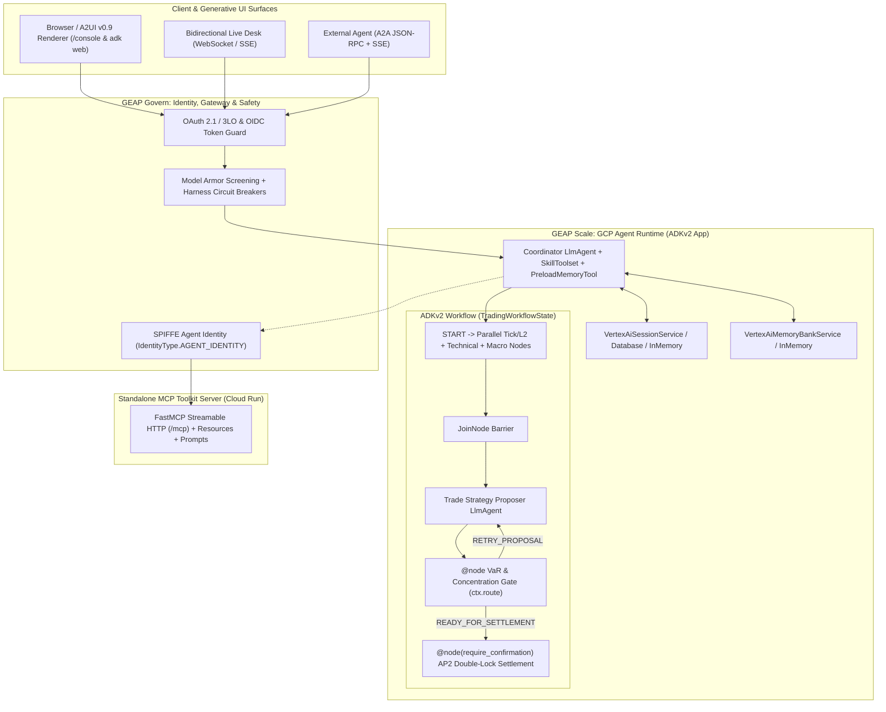

# AlphaPulse: GCP-Native ADKv2 Realtime Quantitative Trading & Agentic Settlement Desk

[](LICENSE)
[](pyproject.toml)
[](https://google.github.io/adk-docs/)
[](app/server.py)

## 1. Problem & Solution Statement

### The Problem
Institutional and active quantitative traders face fragmented, manual pre-trade workflows: streaming intraday ticks, checking Level-2 orderbook liquidity, computing technical regimes (RSI, MACD, Bollinger Bands, VWAP), calculating post-trade 95% Value-at-Risk (VaR), and verifying order limits across siloed screens. Naive single-LLM trading bots introduce severe operational hazards—hallucinating position sizes, bypassing risk caps, sending executable UI code across trust boundaries, or submitting unauthorized trades without cryptographic user attestation.

### The Solution: AlphaPulse
**AlphaPulse** is a production-grade, GCP-native **Realtime Multi-Agent Quantitative Trading & Risk Desk** built on **Google ADKv2 (`google-adk` 2.x)**, frontier **Gemini 3.8 Flash (`gemini-3.8-flash`) + Gemini 3.8 Live (`gemini-3.8-live`)** routing (with configurable upgrade to `gemini-4-carbon`), and the **Gemini Enterprise Agent Platform (GEAP)** architecture (**Build, Scale, Govern, Optimize**). It combines:
1. **ADKv2 Graph Orchestration (`google.adk.workflow.Workflow`)**: Parallel market intelligence fan-out (`START` -> Tick/L2, Technical Regime, Macro Catalyst nodes -> `JoinNode` barrier), iterative VaR position-sizing loops (`ctx.route`), typed `TradingWorkflowState` validation, and human-in-the-loop (`require_confirmation`) resumption.
2. **Standalone MCP Toolkit (`mcp_toolkit/`)**: Exposes all 10 quantitative, risk, UI, and settlement tools plus MCP Resources (`ui://alphapulse/trading-blotter`) over **Streamable HTTP (`/mcp`)**, **SSE**, and **Stdio**, guarded by **OAuth 2.1 / GCP Agent Identity JWT scope verification**.
3. **Full Open Agentic Protocol Stack**:
   - **A2A (`Agent2Agent`)**: `/.well-known/agent.json` `AgentCard` + federated `RemoteA2aAgent` macro specialist.
   - **A2UI (`v0.9`)**: Safe, declarative flat-component generative UI cards (`createSurface`, `updateComponents`, `updateDataModel`) + ADK `UiWidget(provider='mcp')`.
   - **AP2 (`v0.2 Agent Payments Protocol`)**: Double-lock cryptographic mandates (`IntentMandate` -> Broker-signed `CartMandate` -> Trader-signed `CheckoutMandate` & `PaymentMandate`) preventing price tampering or unauthorized fills.
   - **Streaming & HTTP**: REST OpenAPI, **SSE** (`/run_sse` + `/api/v1/stream/ticks/{symbol}`), and **Bidirectional WebSockets** (`/api/v1/ws/live-desk` / `LiveRequestQueue`).

---

## 2. System Architecture



---

## 3. L200 Assessment Rubric Mapping (95-Point Criteria)

| Evaluation Criterion | Implementation Highlights | Key Source Files |
| :--- | :--- | :--- |
| **1. Tool & Interface Design** | 10 typed quant/risk/settlement tools with rich docstrings, standalone **FastMCP** server (`/mcp` Streamable HTTP + MCP Resources + Prompts), **OAuth 2.1** scope enforcement, **A2A** `AgentCard`, **A2UI v0.9** declarative surfaces, and **AP2 v0.2** double-lock mandates. | `mcp_toolkit/server.py`, `trading_agent/tools/`, `trading_agent/protocols/` |
| **2. Context & Memory** | Multi-tier **`SessionService`** (`VertexAiSessionService` / SQLite / `InMemory`) + **`MemoryService`** (`VertexAiMemoryBankService` + `PreloadMemoryTool`) wrapped in deterministic **`PiiScrubbingSessionService` & `PiiScrubbingMemoryService`** proxies (`services.py`), all 4 ADKv2 state scopes (`unprefixed`, `user:*`, `app:*`, `temp:*`), Pydantic `TradingWorkflowState`, `EventsCompactionConfig` (32k tokens), `ContextCacheConfig`, and `ResumabilityConfig`. | `trading_agent/memory.py`, `trading_agent/pii_scrubber.py`, `services.py`, `trading_agent/state_schema.py` |
| **3. Orchestration & Logic** | Native **ADKv2 `Workflow` DAG/Cycle engine** (`START`, parallel fan-out, `JoinNode`, conditional `ctx.route` risk refinement loop, `RetryConfig`, `require_confirmation` HITL gate), `SkillToolset` (`SKILL.md`), Coordinator `LlmAgent`, and federated `RemoteA2aAgent`. | `trading_agent/workflow_graph.py`, `trading_agent/skills/`, `trading_agent/agent.py` |
| **4. Observability & Tracing** | **`TradingHarnessPlugin(BasePlugin)`** intercepting run/model/tool/error hooks, **defense-in-depth PII/SPII & secret redaction pipeline** (`PiiRedactingLogFilter`, `PiiScrubbingSpanProcessor`, salted SHA-256 `user_id` pseudonymization, sensitive-key + regex masking for emails/SSNs/cards/IBANs/phones/IPs/JWTs/API keys + optional Cloud SDP/DLP hook), **OpenTelemetry** `TracerProvider` + `CloudTraceSpanExporter`, structured JSON Cloud Logging, Model Armor prompt sanitization, and **ADK `EvalSet`** (`trading_desk.evalset.json`). | `trading_agent/pii_scrubber.py`, `trading_agent/harness.py`, `trading_agent/memory.py`, `evaluations/trading_desk.evalset.json` |
| **5. Infrastructure & CI/CD** | Multi-stage non-root `uv` **`Dockerfile`**, **`deployment/deploy_agent_runtime.py`** (`IdentityType.AGENT_IDENTITY`), **Terraform IaC** (Cloud Run v2, Artifact Registry, Secret Manager, least-privilege IAM, GEAP APIs), **Cloud Build**, and **GitHub Actions** (`ci.yml` + keyless WIF `deploy.yml`). | `Dockerfile`, `deployment/terraform/`, `.github/workflows/`, `agent.py` |

### Defense-in-Depth PII / SPII & Secret Redaction Pipeline
Every observability and persistence boundary scrubs sensitive personal and financial data **before** storage or export (`trading_agent/pii_scrubber.py`):
1. **Structured JSON Logs (`PiiRedactingLogFilter` & `TradingHarnessPlugin._emit_structured_log`)**: Masks emails, US SSNs, Luhn-validated payment cards, brokerage account IDs / IBANs, phone numbers, public IPv4s, Bearer JWTs, API keys, and sensitive dict keys (`password`, `api_key`, `access_token`, `ssn`, `account_number`, etc.), while one-way hashing `user_id` via salted SHA-256 (`uid_<12-hex>`).
2. **OpenTelemetry Distributed Tracing (`PiiScrubbingSpanProcessor`)**: Registered ahead of `SimpleSpanProcessor` and `CloudTraceSpanExporter` so all span attributes (`adk.tool.intent_redacted`, `adk.tool.outcome_redacted`) are scrubbed in-place prior to export.
3. **Session State & Memory Bank Pipelines (`PiiScrubbingSessionService` & `PiiScrubbingMemoryService` in `trading_agent/memory.py` + `services.py`)**: Deep-copies and scrubs `Session.state`, `Event` text/tool payloads, `update_trader_mandate` notes, and `MemoryService.add_session_to_memory` / `search_memory` payloads before persisting to SQLite, `VertexAiSessionService`, or `VertexAiMemoryBankService` (with optional Google Cloud SDP / DLP `content.deidentify` pass via `ALPHAPULSE_ENABLE_CLOUD_SDP=TRUE`).

---

## 4. Quickstart (Zero External Keys Required for Local Testing)

### Prerequisites
- Python `3.11+` and [`uv`](https://docs.astral.sh/uv/)

### 1. Install & Run Conformance Test Suite
```bash
uv sync --all-groups
uv run pytest -v --cov=trading_agent --cov=mcp_toolkit --cov=app
```

### 2. Launch the Multi-Protocol Gateway & Interactive A2UI Console
```bash
cp .env.example .env
# Set GOOGLE_CLOUD_PROJECT (Vertex AI) or GOOGLE_API_KEY (AI Studio) in .env for live LLM calls
uv run uvicorn app.server:app --host 0.0.0.0 --port 8080 --reload
```
- **Interactive A2UI v0.9 & Protocol Console**: `http://localhost:8080/console`
- **ADK Developer Web UI**: `http://localhost:8080/dev-ui` (or run `uv run adk web .`)
- **A2A Agent Card**: `curl http://localhost:8080/.well-known/agent.json`
- **Live SSE Market & A2UI Delta Stream**: `curl -N "http://localhost:8080/api/v1/stream/ticks/GOOGL?max_events=5"`
- **Standalone MCP Toolkit Server**: `uv run python -m mcp_toolkit.server --transport streamable-http --port 8081`

### 3. Run ADK Trajectory Evaluation
```bash
uv run adk eval trading_agent evaluations/trading_desk.evalset.json \
  --config_file_path=evaluations/test_config.json
```

---

## 5. Deploying to Google Cloud (GCP Agent Runtime & Cloud Run)

### Deploy ADKv2 App to GCP Agent Runtime with SPIFFE `AGENT_IDENTITY`
```bash
export GOOGLE_CLOUD_PROJECT="your-gcp-project-id"
export GOOGLE_CLOUD_LOCATION="us-central1"

uv run python deployment/deploy_agent_runtime.py \
  --project "$GOOGLE_CLOUD_PROJECT" \
  --location "$GOOGLE_CLOUD_LOCATION" \
  --staging-bucket "gs://${GOOGLE_CLOUD_PROJECT}-alphapulse-staging"
```

### Provision Cloud Run MCP Gateway & IAM with Terraform
```bash
cd deployment/terraform
terraform init
terraform plan -var="project_id=${GOOGLE_CLOUD_PROJECT}" \
               -var="container_image=us-central1-docker.pkg.dev/${GOOGLE_CLOUD_PROJECT}/alphapulse-containers/alphapulse:latest"
```

---

## 6. Walkthrough Script (3-Minute Demo Video Guide)

1. **0:00–0:35 — Problem & Architecture**: Show the Mermaid diagram in `README.md` explaining why institutional trading requires deterministic risk gates, MCP tool isolation, A2UI safe declarative rendering, and AP2 cryptographic mandates.
2. **0:35–1:25 — Code Tour (`trading_agent/` & `mcp_toolkit/`)**: Highlight `workflow_graph.py` (ADKv2 `Workflow`, parallel fan-out, `JoinNode`, `ctx.route` VaR loop), `harness.py` (`TradingHarnessPlugin` + Model Armor + OpenTelemetry), and `ap2_mandates.py` (double-lock SHA-256 signatures).
3. **1:25–2:25 — Live Multi-Protocol Demo (`/console` & `adk web`)**: Stream live `GOOGL` SSE ticks, render the A2UI v0.9 Market Pulse card, mint a scoped OAuth 2.1 token to call `POST /mcp`, trigger a `$100k` oversized order to watch the VaR gate auto-resize it, and sign an AP2 `PaymentMandate` to settle an idempotent paper fill.
4. **2:25–3:00 — Verification & CI/CD**: Run `uv run pytest -v` and show `.github/workflows/ci.yml` + `deployment/deploy_agent_runtime.py` (`IdentityType.AGENT_IDENTITY`).

## License
Apache License 2.0 — see [LICENSE](LICENSE).
